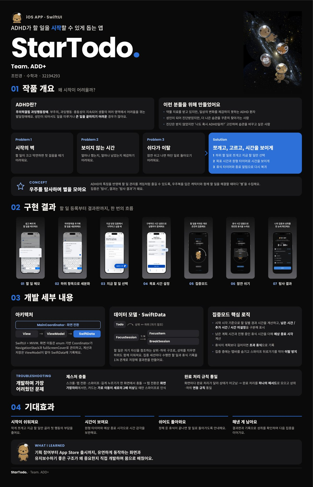
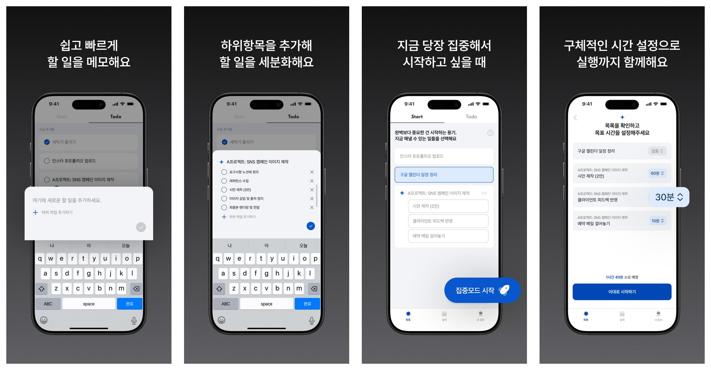
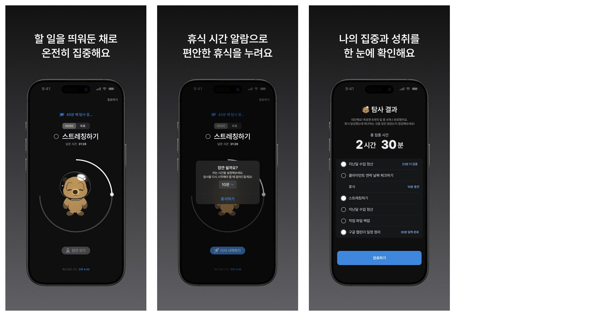
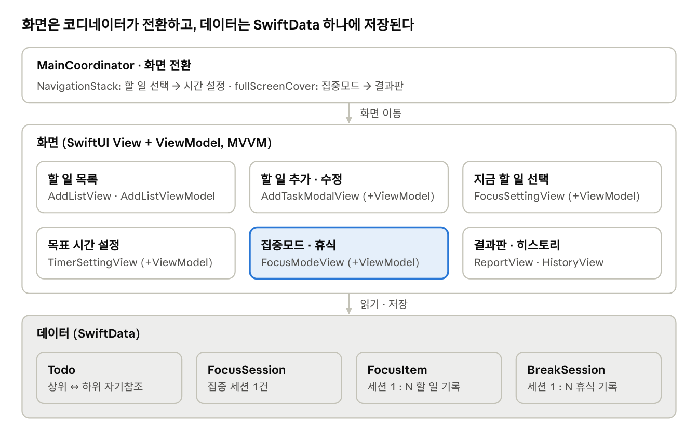

<p align="center">
  
</p>

<h1 align="center">StarTodo (스타트두)</h1>

<p align="center"><b>ADHD가 할 일을 시작할 수 있게 돕는 iOS 할 일 관리 · 집중 타이머 앱</b></p>

<p align="center">
  2026 졸업작품 · Team <b>ADD+</b> · 조민경 (수학과, 32194293)
</p>

---

## 📎 제출 자료

| 자료 | 링크 |
| --- | --- |
| 🎬 시연 영상 | 추가 예정 |
| 🖼️ 포스터 (90×140cm) | [PDF](docs/StarTodo_poster.pdf) · [JPG](docs/StarTodo_poster.jpg) |
| 📄 결과보고서 | [PDF](docs/StarTodo_report.pdf) |
| 💻 소스 코드 | 이 저장소 (`develop` 브랜치) |

<p align="center">
  
</p>

---

## 💡 프로젝트 소개

ADHD가 있는 사람은 할 일이 크고 막연하면 **시작하기 어렵고**, 얼마나 했는지 **시간이 잘 보이지 않으며**, 잠깐 쉬고 나면 **하던 일로 돌아오기 어렵습니다.**
StarTodo는 큰 일을 작게 쪼개고, 지금 할 일만 골라, 눈에 보이는 타이머와 함께 하나씩 끝내도록 돕습니다.

할 일 관리를 게임처럼 즐길 수 있도록 **우주 콘셉트**를 적용했습니다. 우주복을 입은 캐릭터와 함께 집중은 ‘탐사’, 결과는 ‘탐사 결과’가 되고, 할 일을 해결할 때마다 ‘별’을 모읍니다.

> App Store에 출시했던 앱입니다. 현재는 Apple 개발자 프로그램 구독이 끝나 App Store에서 내려간 상태입니다.

## ✨ 주요 기능

| 단계 | 화면 | 내용 |
| --- | --- | --- |
| 1 | 할 일 메모 | 오늘·이전 할 일을 구분해 보고 완료 체크, 완료한 일은 매일 오전 5시에 정리 |
| 2 | 하위 항목으로 세분화 | 큰 할 일 아래 작은 단계를 추가 (최대 10개), 하위를 모두 끝내면 상위도 완료 |
| 3 | 지금 할 일 선택 | 지금 해낼 수 있는 일만 골라 집중모드 시작 |
| 4 | 목표 시간 설정 | 할 일마다 목표 시간(또는 ‘없음’) 설정, 총 소요 시간 자동 합산 |
| 5 | 집중모드 | 원형 타이머, 남은 시간 / 추가 시간, 예상 종료 시각, 타이머 ↔ 목록 전환 |
| 6 | 잠깐 쉬기 | 휴식 타이머, 휴식이 끝나면 앱 안내와 로컬 알림으로 복귀 |
| 7 | 탐사 결과 · 히스토리 | 총 집중 시간, 완료한 일, 휴식 기록, 연·월별 집중 기록 |

<p align="center">
  
  
</p>

## 🧱 아키텍처

- **SwiftUI + MVVM**: 화면(View)은 표시만, 계산·저장은 ViewModel이 담당
- **MainCoordinator**: `enum` 기반 경로(`MainScreen`, `FullScreenCoverRoute`)로 `NavigationStack`과 `fullScreenCover`를 관리
- **SwiftData**: `Todo`(상위·하위 자기 참조), `FocusSession` 1 : N `FocusItem` / `BreakSession`

<p align="center">
  
</p>

```
StarTodo/
├── App/              앱 진입점, ContentView, 스플래시 표시
├── Coordinators/     MainCoordinator (화면 전환)
├── Model/            SwiftData 모델 (Todo, FocusSession, FocusItem, BreakSession)
├── Main/             할 일 목록(AddList), 집중할 일 선택(FocusSetting)
├── TimerSettingView/ 목표 시간 설정
├── FocusModeView/    집중모드 (타이머, 목록, 휴식)
├── Report/           탐사 결과
├── HistoryView/      히스토리
├── SplashView/       스플래시 (별 배경)
├── Manager/          휴식 종료 알림 등
├── Debug/            시연용 더미데이터 (Debug 빌드 전용)
├── Font/ AppShared/  폰트, 공통 UI
└── Assets.xcassets
```

## ▶️ 실행 방법

**요구 사항**: macOS, Xcode 16 이상, iOS 17 이상 시뮬레이터 또는 iPhone

```bash
git clone https://github.com/happier0609/StarTodo.git
cd StarTodo
open "StarTodo .xcodeproj"   # 프로젝트 파일 이름 중간에 공백이 있습니다
```

Xcode에서 실행 대상(iPhone 시뮬레이터 또는 기기)을 고른 뒤 **Run(⌘R)** 합니다.
실제 iPhone에서 실행하려면 *Signing & Capabilities*에서 본인 Apple ID 팀을 선택하세요.

> iOS 앱은 서명 없이 배포 가능한 실행 파일(.ipa)을 공개할 수 없어, 위와 같이 소스에서 빌드해 실행합니다.

### 시연용 더미데이터 (선택)

*Product ▸ Scheme ▸ Edit Scheme… ▸ Run ▸ Arguments*의 **Arguments Passed On Launch**에 추가합니다.

| 인자 | 동작 |
| --- | --- |
| `-seedDemoData` | 실행할 때마다 기존 데이터를 지우고 오늘 할 일·이전 할 일·최근 6주 집중 기록을 넣음 |
| `-demoShortTimer` | 목표 시간·휴식 시간 선택지에 1분 추가 |

두 옵션은 **Debug 빌드에서만** 동작하며 출시 빌드에는 영향이 없습니다.

## 🤖 AI 코딩 도구 활용

개발은 직접 진행했고, AI(Claude)는 두 시점에 활용했습니다. 자세한 내용은 [결과보고서](docs/StarTodo_report.pdf) 7장에 있습니다.

- **개발 중**: 스스로 해결하지 못한 문제(MVVM 구조, CoreData → SwiftData 전환, 폰트 적용 오류)에 설명을 받아 직접 구현
- **최종 점검 (2026.11.15)**: Claude Code로 코드 리뷰와 오류 수정 → PR [#126](../../pull/126), [#127](../../pull/127), [#128](../../pull/128), [#129](../../pull/129)
  - 시작 시각 기준 시간 계산, 휴식 종료 알림, 히스토리 표시 오류, id 기반 할 일 매칭
  - 스플래시 복구, 집중 목록 순서·예상 종료 시각 수정, 설계 플로우 누락 기능(하위 10개 제한, 빈 목록 안내) 반영
  - 시연용 더미데이터 (Debug 전용)
- AI가 작성한 커밋에는 `Co-Authored-By: Claude` 표시가 있습니다. 그 외 코드는 직접 작성했습니다.

## 👥 팀

| 이름 | 소속 | 역할 |
| --- | --- | --- |
| 조민경 | 수학과, 32194293 | 개발 전체, 기획 일부(도메인 조사, 앱 플로우 설계) |

기획자 1명, 디자이너 1명이 외부 인원으로 함께 참여했습니다(학교 구성원이 아니어서 인적 사항은 적지 않습니다).

## 🛠 기술 스택

Swift 5 · SwiftUI · SwiftData · UserNotifications · Xcode · Git / GitHub
폰트: Pretendard, Spartan (SIL Open Font License)

---

<details>
<summary>개발 규칙 (이슈 · 브랜치)</summary>

### 🏷️ 이슈 태그

| 🏷️ Label | 📌 설명 |
|-----------|---------|
| ✨ `feature` | 새로운 기능 제안 및 구현 |
| 🐞 `bug` | 버그 리포트 및 수정 요청 |
| 🎨 `design` | UI/UX 관련 수정 및 개선 |
| 📚 `docs` | 문서 작성 및 수정 (README 등) |
| 🔧 `refactor` | 코드 리팩토링 (기능 변화 없음) |
| 🛠️ `fix` | 사소한 코드/오류 수정 |
| 🧱 `model` | 모델 관련 작업 |

### 📝 이슈 제목
- `[feature] 집중모드 타이머 추가`
- `[bug] 앱 실행 시 크래시 발생`

### 🌿 브랜치 이름
- `feature/12-focus-timer`, `bugfix/8-login-crash`, `design/15-main-ui`

</details>
